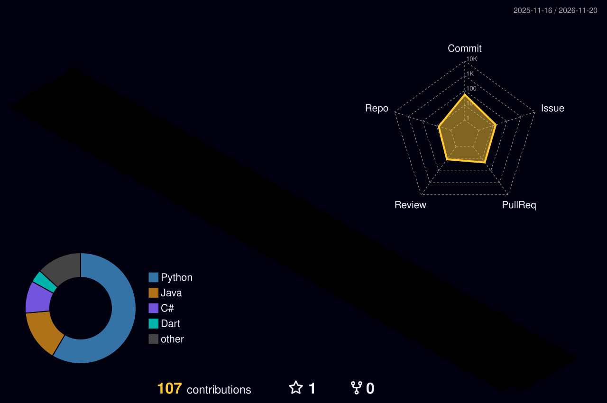

 

**Computer Science Student**

**AI · Backend Development · Cybersecurity**

 

### Connect with Me

 
 

---

### 🛠 Tech Stack

**Languages**

 

**Tools & Technologies**

 

 

---

### 📈 3D Contribution Graph

 

